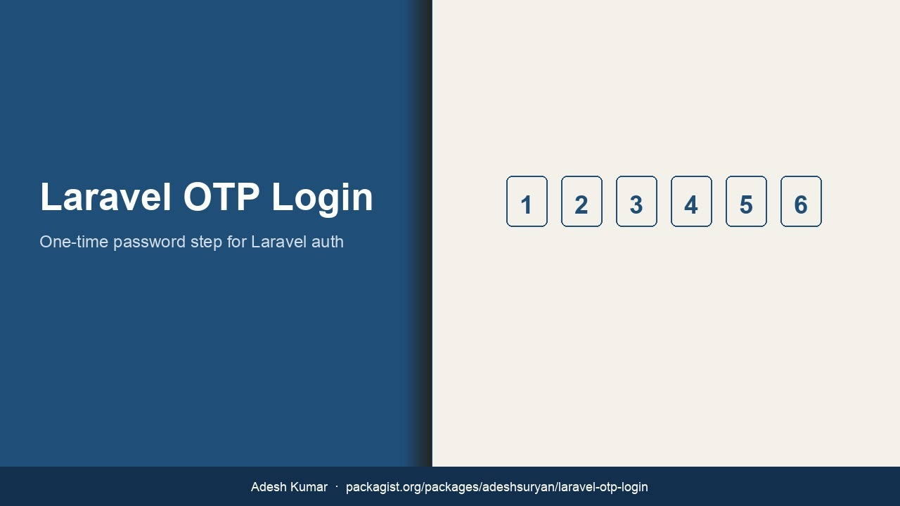

# Laravel OTP Login



Adds a one-time password step after a successful Laravel login. Delivery is pluggable: local `log` / `array` channels for development and CI, `mail` for Mailpit or real SMTP, and optional SMS adapters (Twilio, Nexmo/Vonage, Msg91, BioTekno).

Packagist: [adeshsuryan/laravel-otp-login](https://packagist.org/packages/adeshsuryan/laravel-otp-login)  
GitHub: [adeshsuryan/laravel-otp-login](https://github.com/adeshsuryan/laravel-otp-login)

## Choose the right version

**Pin the package major to your Laravel major.** Legacy tags stay frozen for existing installs.

| Laravel | Package constraint | PHP | Status |
| --- | --- | --- | --- |
| 12.x | `adeshsuryan/laravel-otp-login:^12.0` | ^8.2 | **supported** — latest is `12.1.0` |
| 11.x | `adeshsuryan/laravel-otp-login:^11.0` | ^8.2 | security fixes shipped in `11.1.0`; Laravel 11 itself is EOL — Composer's advisory policy may block it; upgrade Laravel |
| 10.x | `adeshsuryan/laravel-otp-login:^10.0` | ^8.1 | security fixes shipped in `10.1.0`; Laravel 10 is EOL — upgrade |
| 9.x | `adeshsuryan/laravel-otp-login:^9.0` | ^8.0 | security fixes shipped in `9.1.0`; Laravel 9 and PHP 8.0 are EOL — upgrade |
| 8.x | `adeshsuryan/laravel-otp-login:^8.0` | ^7.3\|^8.0 | security fixes shipped in `8.1.0`; Laravel 8 and PHP ≤8.1 are EOL — upgrade |
| 5.x | `adeshsuryan/laravel-otp-login:5.13` (or `5.8`, …) | historical | **frozen** |

> EOL note: Composer's default `policy.advisories.block` now refuses to install
> Laravel majors whose entire line carries security advisories (8/9/10/11).
> The package tags for those lines remain for pinned applications; they are
> not a recommendation to stay on an EOL framework.

```bash
# Modern
composer require adeshsuryan/laravel-otp-login:^12.0

# Legacy Laravel 5 app — do not jump to ^12
composer require adeshsuryan/laravel-otp-login:5.13
```

Tags `0.1`–`5.13` are immutable historical releases for older Laravel 5-era apps.

## Install (Laravel 8–12)

```bash
composer require adeshsuryan/laravel-otp-login:^12.0
php artisan vendor:publish --tag=otp-config
php artisan migrate
```

Package discovery registers `OTPServiceProvider` automatically.

### Environment

```env
OTP_SERVICE_ENABLED=true
OTP_SERVICE=log
OTP_TIMEOUT=600
OTP_DIGIT_LENGTH=6
OTP_USER_PHONE_FIELD=phone
OTP_AFTER_LOGIN_REDIRECT=/home

# Security controls (defaults since *.1.0)
OTP_ENCODE_PASSWORD=true        # OTPs stored hashed, not plaintext
OTP_MAX_ATTEMPTS=5              # wrong codes before the OTP is discarded
OTP_VERIFY_THROTTLE=10,1        # route throttle: max 10 requests / minute
OTP_FAIL_OPEN=false             # keep false — true admits users with no OTP
```

For CI and automated browsers use `OTP_SERVICE=array` or `OTP_SERVICE=mail` with Mailpit. Do not put Twilio/Nexmo keys in the test matrix.

**Upgrading from `*.0.x`?** Read [UPGRADING.md](UPGRADING.md) — `*.1.0`
changes storage defaults and the trusted-device cookie, and adds a migration.

### After password login

Create a waiting OTP and send it:

```php
use adeshsuryan\LaravelOTPLogin\OneTimePassword;

$otp = OneTimePassword::create([
    'user_id' => $user->id,
    'status' => 'waiting',
]);
$otp->send($user);
// redirect to route('otp.view')
```

Routes (middleware `web` + `auth`):

- `GET /login/verify` → `otp.view`
- `POST /login/check` → `otp.verify`

Optional middleware alias: `otp.verified`.

### Channels

| Key | Use |
| --- | --- |
| `log` | Default. Writes OTP to the Laravel log (and caches last OTP for tests). |
| `array` | Cache only. Best for PHPUnit. |
| `mail` | Laravel Mail (pair with Mailpit in Docker). |
| `twilio` / `nexmo` / `msg91` / `biotekno` | Optional production SMS. |

Custom channel: implement `adeshsuryan\LaravelOTPLogin\ServiceInterface` and register the class under `config/otp.php` → `services`.

## Tests

```bash
composer install
composer test
```

## License

MIT. See [LICENSE.md](LICENSE.md). Maintained by Adesh Kumar.
